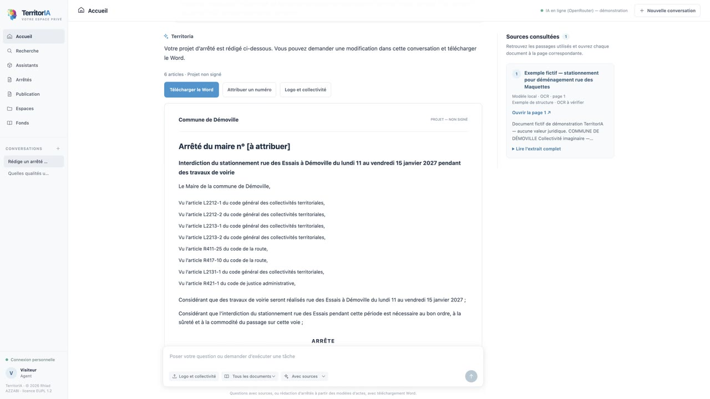
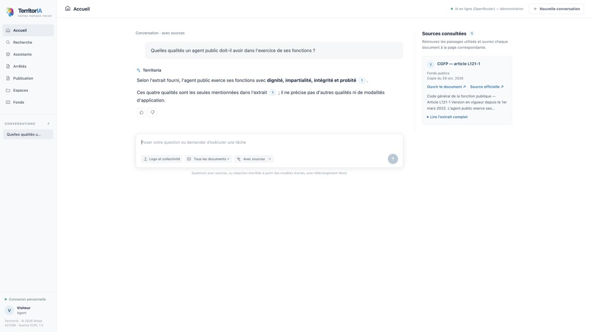
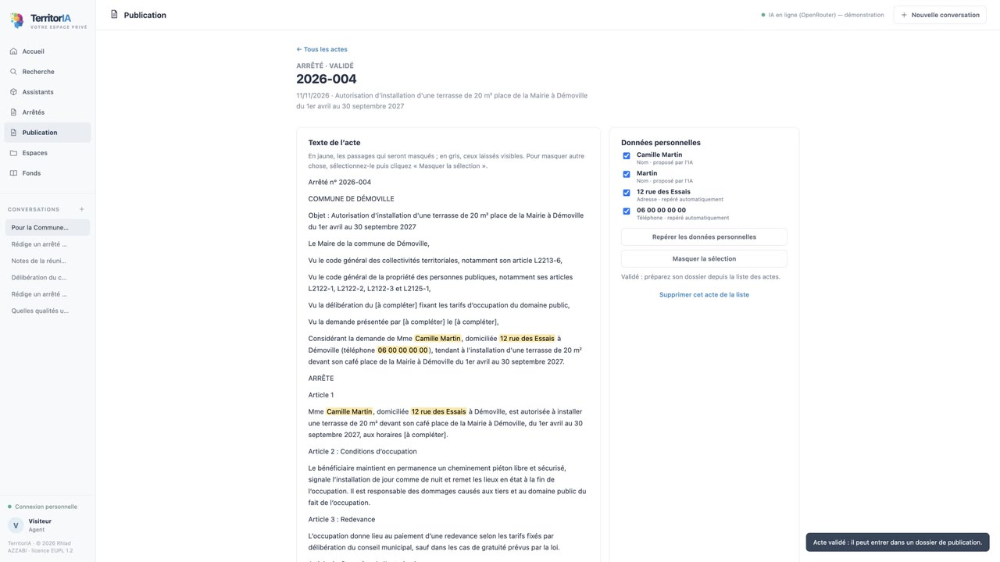
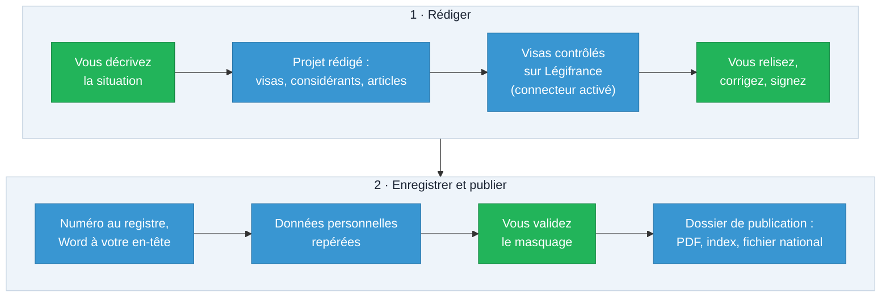
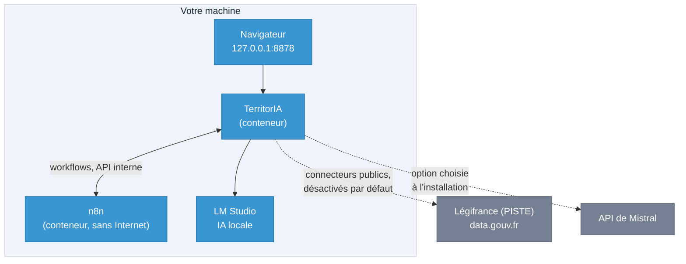

# TerritorIA

<p align="center">
  
</p>

<p align="center">
  <b>Rédiger les actes, répondre avec les sources, publier sans exposer personne.</b><br>
  Un logiciel libre pour les collectivités, dont l'IA tourne par défaut sur votre propre machine.
</p>

<p align="center">
  <a href="https://github.com/didou92i/territoria/releases/latest"></a>
  <a href="#licence-et-auteur"></a>
  <a href="https://github.com/didou92i/territoria/actions/workflows/ci.yml"></a>
  
</p>

<p align="center">
  <a href="https://github.com/didou92i/territoria/releases/download/v0.2.0/territoria-presentation.mp4"><b>Voir la vidéo (2 min)</b></a> ·
  <a href="https://demo.territoria.ovh"><b>Essayer la démonstration</b></a> ·
  <a href="#deux-façons-dinstaller"><b>Installer</b></a> ·
  <a href="docs/guide-debutant.md"><b>Guide pour débutant</b></a> ·
  <a href="https://territoria.ovh"><b>Site</b></a>
</p>

TerritorIA est une plateforme pour les agents de la fonction publique territoriale : rédiger des actes et documents
administratifs (arrêtés, comptes rendus, notes), poser des questions sourcées sur des documents, utiliser des assistants
métiers. Par défaut, elle fonctionne **entièrement en local**, parce que ces agents traitent des données personnelles
et confidentielles.

## Aperçu

<table>
  <tr>
    <td width="33%"></td>
    <td width="33%"></td>
    <td width="33%"></td>
  </tr>
  <tr>
    <td align="center"><b>Un arrêté rédigé à partir d'une phrase</b><br>visas, considérants, articles, puis Word</td>
    <td align="center"><b>Une réponse, avec sa source</b><br>le passage cité s'ouvre à la bonne page</td>
    <td align="center"><b>Publier sans exposer personne</b><br>données personnelles repérées, masquage validé</td>
  </tr>
</table>

Ces captures viennent de la démonstration en ligne : commune imaginaire, données fictives, IA en ligne (voir
[`docs/demonstration.md`](docs/demonstration.md)). La [vidéo de présentation](https://github.com/didou92i/territoria/releases/download/v0.2.0/territoria-presentation.mp4)
(2 minutes, MP4, 31 Mo, jointe à la version 0.2.0) montre le parcours complet.

## Ce que fait TerritorIA

| Pour… | TerritorIA… |
| --- | --- |
| **Rédiger un acte** | prépare arrêtés (police temporaire, RH, délégations, débit de boissons, stationnement, marchés, police générale) et délibérations, avec visas Légifrance et export Word au papier à en-tête. |
| **Tenir le registre** | inscrit chaque acte au registre et lui attribue son numéro. |
| **Publier un acte** | propose l'anonymisation, que vous validez, puis prépare le dossier à déposer sur le site : PDF, index et fichier national des délibérations (voir [`docs/publication.md`](docs/publication.md)). |
| **Répondre à une question** | cherche dans vos documents et cite ses sources : OCR des PDF scannés, recherche par le sens. |
| **Gagner du temps au quotidien** | met à disposition 22 assistants, dont réponse à un courrier et compte rendu de réunion. |
| **Suivre les séances** | transcrit la séance (2 heures au plus) avec ses intervenants, puis rédige compte rendu, procès-verbal (mentions de l'article L2121-15 du CGCT) et liste des délibérations à partir de la transcription validée, au papier à en-tête. |
| **Administrer** | gère comptes, rôles, droits par espace, connecteurs et retours des agents. |

## Le parcours d'un acte

TerritorIA rédige et contrôle ; vous décidez à chaque étape. En bleu, ce que fait le logiciel ; en vert, ce qui reste
entre vos mains.



## Comment ça marche : tout en local par défaut



En une ligne :

```
navigateur → TerritorIA (conteneur) → n8n (conteneur) → TerritorIA (API interne) → LM Studio (IA locale, sur la machine)
```

- 100 % local par défaut. Option : l'API de Mistral, choisie à l'installation, en connaissance de cause.
  Sans cette option, le seul serveur d'IA accepté est un serveur local compatible OpenAI (LM Studio par défaut) ;
  avec elle, voir [`docs/mistral.md`](docs/mistral.md) : ce qui part chez Mistral et les démarches RGPD.
- En fonctionnement, sans l'option Mistral, les seules connexions sortantes sont celles des connecteurs publics,
  désactivés par défaut et activés par l'administration : Légifrance par PISTE (références et dates de textes
  publics) et data.gouv.fr (mots de la recherche, puis le fichier choisi). Jamais un document, une conversation ou un
  nom d'agent. `TERRITORIA_HORS_LIGNE=1` les coupe : les textes déjà en cache restent utilisables, avec leur date, et
  l'arrêté rédigé demande de vérifier qu'ils sont toujours en vigueur.
  Avec l'option Mistral, les requêtes d'IA partent chez Mistral, même en mode hors ligne : celui-ci ne coupe que
  les connecteurs publics.
- n8n n'a aucune sortie vers Internet (réseau interne des conteneurs, `internal`) ; seul le conteneur `territoria` a un
  second réseau, pour Légifrance, LM Studio sur la machine (ou l'API de Mistral, avec l'option) et son port publié. Les appels entre TerritorIA, n8n et
  LM Studio ne passent jamais par un proxy, même si la machine en a un.
- Mode **solo** : l'interface n'est joignable que depuis la machine (`http://127.0.0.1:8878`) ; l'éditeur de n8n n'est
  publié nulle part. Le mode **équipe** (plusieurs postes, serveur dans les locaux ou VPS, en HTTPS) n'est pas encore
  livré : TerritorIA refuse de démarrer en écoute réseau.
- L'installation et les mises à jour téléchargent des images, un modèle d'IA et du code ; ces téléchargements ne
  transportent aucune donnée de la collectivité.

## État du projet

Novembre 2026 : version pilote 0.2.0, sur un poste.

- **Fonctionne** : tout ce que décrit le tableau « Ce que fait TerritorIA » ci-dessus.
- **Pas encore** : enregistrement en direct, courriers au papier à en-tête, mode équipe.
- **Pilote** : [`docs/pilote.md`](docs/pilote.md).

## Licence et auteur

TerritorIA est créé par **Rhiad AZZABI**, entreprise individuelle TerritorIA (SIREN 989 227 731). Il est libre et
gratuit, sous la **licence publique de l'Union européenne (EUPL 1.2)** : texte officiel en français dans [`EUPL-1.2-fr.txt`](EUPL-1.2-fr.txt) et en anglais dans [`LICENSE`](LICENSE),
mentions d'auteur et composants tiers dans [`NOTICE.md`](NOTICE.md). Toute copie ou version modifiée doit conserver ces
mentions, et une version modifiée doit rester sous EUPL 1.2. Pour signaler une faille de sécurité :
[`SECURITY.md`](SECURITY.md).

## Deux façons d'installer

**Première installation, sans connaissances techniques ?** Suivez le [guide pour débutant](docs/guide-debutant.md).

**Démonstration en ligne** (serveur loué, IA par OpenRouter, données fictives seulement) : voir
[`docs/demonstration.md`](docs/demonstration.md). Sans l'option Mistral, une installation n'envoie jamais rien à une IA
en ligne.

- **Avec un assistant IA** (Codex, Claude Code, GitHub Copilot…) : ouvrez le dépôt avec l'assistant. Il suit
  [`AGENTS.md`](AGENTS.md) (`CLAUDE.md` y renvoie), vous demande l'accord avant chaque étape, et ne lit jamais vos données.
  Les mots de passe et les identifiants sont toujours saisis par vous, dans votre terminal.
- **À la main**, avec les commandes de ce document, qui sont les mêmes que celles de l'assistant.

## Avant de commencer

- **Machine** : macOS, Linux ou Windows 10/11, avec des droits d'administrateur pour installer le moteur de conteneurs.
  La mémoire vive fixe la taille du modèle d'IA (voir l'étape 0). Côté disque, le modèle pèse de 5 à 17 Go selon le
  palier, et les images de conteneurs prennent quelques Go de plus. La transcription des séances ajoute environ 1,7 Go
  de modèles (Whisper large-v3-turbo, licence MIT ; découpage des tours de parole et empreintes de voix, licences MIT
  et Apache 2.0), téléchargés et vérifiés (empreintes SHA-256) à l'étape `demarrer`, puis jamais retéléchargés tant
  qu'ils sont intacts. Le conteneur de transcription (`travaux`) tourne **sans aucun accès réseau** : il ne voit que
  les enregistrements des séances et les modèles ; l'audio est effacé dès que la transcription est validée et n'entre
  jamais dans les sauvegardes.
- **Chiffrement du disque** : activez FileVault (macOS), BitLocker (Windows) ou LUKS (Linux). Le diagnostic signale son
  absence.
- **Licences** : la collectivité installe LM Studio elle-même et en accepte les conditions
  (<https://lmstudio.ai/app-terms>). Docker Desktop est payant pour les administrations : sous Windows et macOS, Podman
  est le moteur par défaut. Ce document n'est pas un avis juridique.
- **Outils** : `git` et un accès Internet pour l'installation et les mises à jour.
- **Récupérer le dépôt**, puis se placer dedans (toutes les commandes se lancent depuis sa racine) :

  ```sh
  git clone https://github.com/didou92i/territoria.git territoria
  cd territoria
  ```

  Les données seront rangées dans un dossier **`territoria-donnees/` créé à côté** du dossier du dépôt (jamais dedans, pour
  qu'un `git clean` ne puisse pas l'effacer).

### Les scripts

Chaque script existe en version `.sh` (macOS, Linux) et `.ps1` (Windows PowerShell 5.1 ou PowerShell 7). Sous Windows, on
les lance ainsi : `powershell -NoProfile -ExecutionPolicy Bypass -File install\<script>.ps1`. Les options sont les mêmes
dans les deux versions.

Chaque script écrit sa progression sur la sortie d'erreur et se termine par une dernière ligne sur la sortie standard,
`ETAPE <nom> : OK` ou `ETAPE <nom> : ECHEC <code>` (code de sortie 0 ou 1). Les codes sont expliqués dans le tableau
« Codes d'échec » d'[`AGENTS.md`](AGENTS.md). Avec `--simulation`, un script affiche les commandes qu'il lancerait sans
rien modifier ni demander.

### Windows : scripts bloqués

Windows peut refuser d'exécuter un script avant sa première ligne : stratégie d'exécution de PowerShell, ou marque
« téléchargé depuis Internet » (Mark-of-the-Web, flux `Zone.Identifier`) posée sur les fichiers d'une archive ZIP (pas sur
un dépôt cloné avec git). Du plus étroit au plus large :

1. `-ExecutionPolicy Bypass`, déjà présent dans les commandes ci-dessous, lève la stratégie pour ce seul processus ;
2. si Windows refuse encore, depuis la racine du dépôt : `Get-ChildItem -Path install -Filter *.ps1 | Unblock-File` ;
3. si `Get-ExecutionPolicy -List` montre une valeur pour `MachinePolicy` ou `UserPolicy`, l'organisation impose sa
   stratégie et `-ExecutionPolicy Bypass` est ignoré : contactez le service informatique.

N'exécutez jamais `Set-ExecutionPolicy -Scope LocalMachine` : ce serait désactiver la protection de toute la machine.

## Installation pas à pas

Dans cet ordre, une étape à la fois. Chaque étape peut être relancée ; chacune se termine par `ETAPE <nom> : OK`. Pour voir
ce qu'une étape fera, ajoutez `--simulation`.

### 0. Diagnostic (aucune modification)

```sh
install/diagnostic.sh
```

```powershell
powershell -NoProfile -ExecutionPolicy Bypass -File install\diagnostic.ps1
```

Onze lignes `clé=valeur` : `systeme`, `architecture`, `memoire_go`, `gpu`, `disque_libre_go`, `port_8878` (`libre`
attendu), `moteur` (`docker`, `podman` ou `aucun`), `docker_desktop`, `lms` (commande de LM Studio), `chiffrement_disque`
et `palier_modele`. Le palier du modèle suit la mémoire : `petit` sous 12 Go (modèle d'environ 4 milliards de paramètres,
5,3 Go), `moyen` de 12 à 27 Go (environ 12 milliards, 7,4 Go), `grand` à partir de 28 Go (environ 27 milliards, 16,8 Go).
Une ligne `avertissement=licence_docker_desktop_payante_pour_les_administrations` signale Docker Desktop : préférez
Podman.

### 1. Moteur de conteneurs

```sh
install/installer.sh --etape moteur
```

```powershell
powershell -NoProfile -ExecutionPolicy Bypass -File install\installer.ps1 --etape moteur
```

Un Docker ou un Podman déjà installé est réutilisé. Sinon : Podman par Homebrew sur macOS (puis `podman machine init`),
Docker Engine depuis les paquets de la distribution sous Linux (`apt-get` ou `dnf`, jamais un script distant), Podman par
`winget` sous Windows (qui a besoin de WSL 2).

**Linux** : le compte est ajouté au groupe `docker`, ce qui donne des droits équivalents à ceux d'administrateur sur la
machine. Ce groupe ne vaut qu'après une nouvelle ouverture de session : à la première installation, l'étape se termine
donc par `ECHEC reconnexion_requise`. C'est normal : fermez votre session (ou redémarrez), rouvrez-la, puis relancez la même
commande.

Retour arrière : macOS `brew uninstall podman` ; Linux `sudo apt-get remove docker.io` (ou `sudo dnf remove moby-engine`)
et `sudo gpasswd -d "$USER" docker` ; Windows `winget uninstall --exact --id RedHat.Podman`.

### 2. LM Studio et modèle

```sh
install/installer.sh --etape lmstudio
```

```powershell
powershell -NoProfile -ExecutionPolicy Bypass -File install\installer.ps1 --etape lmstudio
```

Installe LM Studio s'il manque (Homebrew, installateur officiel de `llmster`, `winget`), **télécharge le modèle du palier**
(5,3 à 16,8 Go), règle son serveur (écoute limitée à la machine, journalisation coupée), le démarre sur le port 1234,
charge le modèle et écrit son adresse dans `territoria-donnees/secrets/compose.env`. Il vérifie que le modèle est servi,
qu'un conteneur le joint, et qu'une requête de test n'apparaît dans aucun journal de LM Studio. `--palier
petit|moyen|grand` remplace le palier recommandé. Détails et réglages par système : [`docs/acces-lmstudio.md`](docs/acces-lmstudio.md).

Sur un LM Studio neuf, ouvrez-le une fois avant l'étape (`lmstudio_dossier_introuvable`, `lms_absent`). Si l'étape
s'arrête sur `journaux_lmstudio_introuvables`, créez le dossier **vide** `server-logs` dans le dossier de LM Studio **qui
existe déjà**, retrouvé comme le fait le script : le chemin écrit dans `~/.lmstudio-home-pointer` s'il existe, sinon
`~/.lmstudio`, sinon `~/.cache/lm-studio` (Windows : le pointeur `%USERPROFILE%\.lmstudio-home-pointer`, sinon
`%USERPROFILE%\.lmstudio`, sinon `%LOCALAPPDATA%\lm-studio`). Ne créez jamais le dossier de LM Studio lui-même : le
script croirait l'avoir trouvé et ne contrôlerait rien. Commande : `mkdir "<dossier de LM Studio>/server-logs"`
(Windows : `Test-Path "<dossier>"` d'abord, puis `New-Item -ItemType Directory -Path "<dossier>\server-logs"`), puis
relancez l'étape.

**Ou bien l'API de Mistral**, au lieu de l'IA locale : `install/installer.sh --etape mistral` (Windows :
`install\installer.ps1 --etape mistral`). L'étape avertit de ce qui part chez Mistral, demande une confirmation
(non par défaut) puis la clé API en saisie masquée. Lire d'abord [`docs/mistral.md`](docs/mistral.md). Pour revenir à
l'IA locale, l'étape `lmstudio` retire l'option.

### 3. Secrets

```sh
install/installer.sh --etape secrets
```

```powershell
powershell -NoProfile -ExecutionPolicy Bypass -File install\installer.ps1 --etape secrets
```

Crée `territoria-donnees/` (sous-dossiers `territoria/`, `n8n/`, `caddy/`, `secrets/`, droits restreints), construit l'image
`territoria` et génère dans `territoria-donnees/secrets/` le jeton de service, le jeton de webhook et la clé de chiffrement
de n8n. Ils ne sont jamais régénérés s'ils existent, jamais affichés, jamais passés en argument. Ne supprimez jamais
`secrets/` une fois n8n démarré : la clé de chiffrement protège la base de n8n.

### 4. Connecteurs publics (Légifrance, data.gouv.fr)

```sh
install/installer.sh --etape legifrance
```

```powershell
powershell -NoProfile -ExecutionPolicy Bypass -File install\installer.ps1 --etape legifrance
```

Pose la question « Autoriser les connecteurs publics (Légifrance, data.gouv.fr), à activer ensuite par l'administration ?
[o/N] ». **Oui** : `TERRITORIA_HORS_LIGNE=0` dans `territoria-donnees/secrets/compose.env`. Les connecteurs restent
désactivés jusqu'à leur activation dans Administration › Connecteurs, où se saisissent aussi les identifiants PISTE de
Légifrance ; data.gouv.fr ne demande pas de compte. **Non** (réponse par défaut) : mode hors ligne
(`TERRITORIA_HORS_LIGNE=1`), aucun connecteur ne peut être activé. Tant que Légifrance n'est pas actif, les visas des
actes viennent de la copie datée des textes livrée avec TerritorIA (ou du dernier cache), et l'acte rédigé demande de
vérifier qu'ils sont toujours en vigueur. Cette copie datée est aussi versée, au démarrage, dans l'espace « Fonds
publics », avec les articles sur le fonctionnement du conseil municipal : les questions avec sources y trouvent de quoi
répondre dès l'installation. Un article que vous supprimez de ce fonds n'y revient pas. L'étape retire de `secrets/territoria.env` les identifiants PISTE qu'une
version précédente y rangeait et que plus rien ne lit : ressaisissez-les dans Administration › Connecteurs. Étape
interactive, à lancer dans un terminal ; relancez-la pour changer d'avis, puis relancez TerritorIA.

### 5. Démarrage

```sh
install/installer.sh --etape demarrer
```

```powershell
powershell -NoProfile -ExecutionPolicy Bypass -File install\installer.ps1 --etape demarrer
```

Démarre le moteur s'il est arrêté, le serveur de LM Studio (il refuse de continuer s'il est ouvert au réseau local) et y
charge le modèle de `secrets/compose.env` s'il ne l'est pas, construit l'image et démarre `n8n` et `territoria` jusqu'à
leur bonne santé. `install/demarrer.sh` fait de même, sans reconstruire. Retour arrière : `install/arreter.sh`.

### 6. n8n : workflows et compte propriétaire

```sh
install/installer.sh --etape n8n
```

```powershell
powershell -NoProfile -ExecutionPolicy Bypass -File install\installer.ps1 --etape n8n
```

Importe et publie les deux workflows de `n8n/workflows/` et leurs deux credentials d'entrée privée, puis crée le compte
propriétaire de n8n (mot de passe généré, rangé dans `secrets/n8n-admin.txt`). L'étape est conçue pour être relancée sans
danger. La mise à jour réimporte elle-même les workflows : rien à relancer après elle.

### 7. Corpus de démonstration

```sh
install/installer.sh --etape demo
```

```powershell
powershell -NoProfile -ExecutionPolicy Bypass -File install\installer.ps1 --etape demo
```

Installe le corpus fictif de la « Commune de Démoville », **seulement s'il n'existe pas déjà une vraie bibliothèque
d'arrêtés** (sinon `ECHEC bibliotheque_etrangere`, sans rien écrire : ce n'est pas une panne).

### 8. Vérification de bout en bout

```sh
install/installer.sh --etape verifier
```

```powershell
powershell -NoProfile -ExecutionPolicy Bypass -File install\installer.ps1 --etape verifier
```

Joue un parcours complet sur des données fictives, puis nettoie : import d'un PDF, recherche, question sourcée au vrai
modèle, arrêté fictif jusqu'au fichier Word, refus des origines tierces et des appels internes sans jeton. Il peut durer
**jusqu'à une trentaine de minutes** sur une machine lente (chaque demande au modèle attend au plus 16 minutes et peut
être rejouée une fois) : un assistant IA le lance en arrière-plan, ou vous le lancez dans votre terminal, et seule la
ligne `ETAPE` finale fait foi (un délai dépassé par l'outil de l'assistant n'est pas un échec). Sur une installation
réelle, on ne passe jamais `--strict` à `outils verifier` : ce mode exige la citation `[1]` que seule la fausse IA de
l'intégration continue produit.

### 9. Raccourci

```sh
install/installer.sh --etape raccourci
```

```powershell
powershell -NoProfile -ExecutionPolicy Bypass -File install\installer.ps1 --etape raccourci
```

Crée sur le bureau un raccourci qui démarre TerritorIA puis ouvre `http://127.0.0.1:8878` (`Territoria.command` sur macOS,
`territoria.desktop` sur Linux, `Territoria.lnk` sous Windows). Pour démarrer aussi à l'ouverture de session, ajoutez
`--auto` (macOS : agent `fr.territoria.demarrer` de launchd ; Linux : `~/.config/autostart/territoria.desktop` ; Windows :
raccourci dans le dossier Démarrage). Retour arrière : supprimer ces fichiers.

### 10. Sauvegarde automatique (en option)

```sh
install/installer.sh --etape sauvegarde-auto
```

```powershell
powershell -NoProfile -ExecutionPolicy Bypass -File install\installer.ps1 --etape sauvegarde-auto
```

Demande un dossier de destination existant (disque externe, serveur de fichiers interne ; ni dans `territoria-donnees/`
ni dans le dépôt) puis un mot de passe (12 caractères au moins, deux saisies masquées), rangé dans
`territoria-donnees/secrets/sauvegarde.motdepasse`. Planifie une sauvegarde chiffrée **tous les jours à 12 h 30**, en
gardant les 7 dernières quotidiennes et les 4 dernières hebdomadaires : agent launchd `fr.territoria.sauvegarde` (macOS),
ligne de crontab marquée `# territoria-sauvegarde-auto` (Linux), tâche `Territoria-Sauvegarde` (Windows, retrait par
`schtasks /Delete /TN Territoria-Sauvegarde /F`). **Gardez une copie du mot de passe ailleurs** : sans lui, les
sauvegardes sont illisibles. Étape interactive : à lancer dans un terminal.

## Au quotidien

- **Démarrer** : le raccourci, ou `install/demarrer.sh` (Windows : `install\demarrer.ps1`) ; `--ouvrir` ouvre ensuite le
  navigateur. L'interface est à `http://127.0.0.1:8878`.
- **Arrêter** : `install/arreter.sh` (Windows : `install\arreter.ps1`). Rien n'est supprimé ; LM Studio reste ouvert.
- **Sauvegarder à la demande** dans un dossier existant (mot de passe saisi deux fois, masqué) :

  ```sh
  install/sauvegarder.sh --destination /chemin/du/dossier
  ```

  ```powershell
  powershell -NoProfile -ExecutionPolicy Bypass -File install\sauvegarder.ps1 --destination D:\Sauvegardes
  ```

  L'archive `territoria-AAAAMMJJ-HHMMSS.tsv1` contient les bases, les documents, les secrets (clé de n8n comprise) et un
  manifeste d'empreintes SHA-256 ; le mot de passe de la sauvegarde n'y est jamais.
- **Restaurer** une archive (ou le dossier qui la contient : la plus récente est prise). Les services sont arrêtés ;
  `territoria-donnees/` doit être vide, sinon `ECHEC cible_non_vide` et l'option `--forcer` remplace `territoria/`,
  `n8n/` et les fichiers de `secrets/` (**faites d'abord une sauvegarde**) :

  ```sh
  install/restaurer.sh --archive /chemin/de/territoria-20261030-123000.tsv1
  ```

  ```powershell
  powershell -NoProfile -ExecutionPolicy Bypass -File install\restaurer.ps1 --archive D:\Sauvegardes\territoria-20261030-123000.tsv1
  ```

  Puis relancez `install/demarrer.sh`.

## Reprise du pilote (Mac du porteur de projet)

Une commande reprend dans la nouvelle installation les données du pilote : la base, les documents, la bibliothèque des
34 arrêtés, les ressources juridiques en cache, les projets d'arrêtés produits, l'identité et les réglages d'IA. Le dossier
`data/` du pilote est monté **en lecture seule** et n'est jamais modifié. L'instance n8n du pilote et ses autres
workflows ne sont pas migrés. Sur un Mac, après l'installation complète (étapes 1 à 8) :

1. **Arrêtez le pilote** (son serveur du port 8877) avec son lanceur habituel : la base est lue sans verrou.
2. **Si l'installation contient déjà des conversations, des documents ou une vraie bibliothèque**, la reprise s'arrête sur
   `ECHEC cible_non_vide`. N'ajoutez `--forcer` qu'**après une sauvegarde** (voir « Au quotidien »).
3. **Arrêtez le service `territoria`, lancez l'import, puis redémarrez.** L'import tourne dans un conteneur ponctuel de
   l'image TerritorIA, avec l'identité du service (pas en root), le dossier `data/` du pilote monté en lecture seule sur
   `/pilote` et le dossier de données de l'installation sur `/donnees`. Les commandes reprennent celles des scripts
   (`compose` de `install/commun.sh`) ; le chemin du pilote contient des espaces, gardez les guillemets :

   ```sh
   export TERRITORIA_DONNEES_HOTE="$(cd .. && pwd -P)/territoria-donnees"
   MOTEUR=docker   # ou podman : la valeur de « moteur= » donnée par le diagnostic
   "$MOTEUR" compose -p territoria --env-file "$TERRITORIA_DONNEES_HOTE/secrets/compose.env" -f conteneurs/compose.yaml stop territoria
   "$MOTEUR" compose -p territoria --env-file "$TERRITORIA_DONNEES_HOTE/secrets/compose.env" -f conteneurs/compose.yaml run --rm --no-deps -T -v "<dossier du pilote>/data:/pilote:ro" territoria python -m outils reprendre-pilote /pilote
   install/demarrer.sh
   ```

   Avec `--forcer` : `python -m outils reprendre-pilote /pilote --forcer`.
4. **Lisez le rapport.** L'import imprime `RAPPORT reprendre-pilote : espaces=… documents=… conversations=… messages=…
   pdf_conformes=… reference_conforme=oui|non` (des nombres et `oui`/`non` seulement), puis `ETAPE reprendre-pilote : OK` ou `ECHEC <code>`.
   Comparez avec le pilote : pour celui du porteur de projet, 2 espaces, 2 documents, 5 conversations, 12 messages,
   34 PDF conformes et `reference_conforme=oui`. Un écart ou un contrôle en défaut donne un `ECHEC`, sans rien remplacer.

Échecs : `pilote_actif` (un journal `-wal` ou `-journal` reste à côté de la base : redémarrez le pilote puis arrêtez-le
proprement, et ne supprimez pas ces fichiers) ; `cible_non_vide` (sauvegarde, puis `--forcer`) ; `source_invalide`,
`chemins_imbriques`, `fichier_inaccessible`, `ecart_de_comptage`, `base_illisible`, `element_ignore`,
`documents_non_conformes`, `reference_non_conforme`, `pdf_non_conformes`. Avec `reprise_interrompue`, l'échange final a
échoué puis son retour arrière aussi : **les données précédentes sont conservées dans
`territoria-donnees/territoria/.reprise-*`**. Intervention manuelle : ne relancez pas l'import et ne supprimez rien avant
d'avoir examiné ce dossier.

## Mise à jour

Les versions sont des étiquettes git.

```sh
install/mettre-a-jour.sh --version v0.2.0
```

```powershell
powershell -NoProfile -ExecutionPolicy Bypass -File install\mettre-a-jour.ps1 --version v0.2.0
```

- **La version** : une étiquette, ou `origin/<branche>` (par exemple `origin/main`). Un nom de branche seul, `main`,
  désigne la branche **locale**, que la récupération des nouveautés ne fait pas avancer. `--destination <dossier>` place la
  sauvegarde d'avant la mise à jour ailleurs que dans `territoria-donnees/mises-a-jour/`.
- **Avant** : le dépôt doit être propre (`git status --porcelain` ne montre rien ; un fichier ajouté ou modifié dans le
  dépôt bloque avec `modifications_locales`). Les dossiers d'état des éditeurs et des assistants (`.claude/`, `.codex/`,
  `.cursor/`, `.vscode/`, `.idea/`, `.continue/`, `.aider*`) sont ignorés par `.gitignore`. Notez la version actuelle
  (`git rev-parse HEAD`).
- **Déroulement** : le script démarre le moteur et LM Studio (modèle chargé), fait une sauvegarde chiffrée qu'il vérifie
  aussitôt (mot de passe de `sauvegarde-auto` s'il existe, sinon il en demande un), passe à la version, reconstruit,
  importe dans n8n les credentials et les workflows de la nouvelle version, redémarre et rejoue le test de bout en bout
  (jusqu'à une trentaine de minutes sur une machine lente). Il n'y a rien à relancer ensuite.
- **Si vous l'interrompez** (Ctrl-C : `ECHEC interrompu`), aucun retour automatique n'a lieu : l'écran donne les trois
  commandes à recopier, une par ligne, chemins déjà protégés (ancienne version, restauration avec `--forcer`,
  redémarrage).
- **Les sauvegardes d'avant mise à jour** sont dans `territoria-donnees/mises-a-jour/` et ne sont **jamais supprimées
  automatiquement** : supprimez vous-même les anciennes, en gardant la plus récente. `territoria-donnees/` est à côté du
  dépôt : depuis la racine du dépôt, `rm -- "../territoria-donnees/mises-a-jour/territoria-AAAAMMJJ-HHMMSS.tsv1"`
  (Windows : `Remove-Item -LiteralPath "..\territoria-donnees\mises-a-jour\territoria-AAAAMMJJ-HHMMSS.tsv1"`).
- **En cas d'échec**, le retour est automatique : conteneurs arrêtés, **données de la tentative ratée déplacées dans
  `echec-AAAAMMJJ-HHMMSS/` dans `territoria-donnees/`** (accès réservé, jamais supprimées automatiquement), sauvegarde restaurée,
  ancienne version rétablie, vérification. Le script se termine par « Mise à jour annulée : version précédente rétablie. »
  et `ECHEC mise_a_jour_annulee`. Ce qui a été écrit entre la sauvegarde et l'échec n'existe **que** dans `echec-*`. Le
  script affiche le chemin complet du dossier (« Les données de la tentative ratée sont conservées dans … ») ; pour le
  supprimer quand vous n'en avez plus besoin, copiez ce chemin tel quel : `sudo rm -rf -- "<chemin affiché>"` sous Linux
  (les fichiers appartiennent aux utilisateurs internes 10001 et 1000), `rm -rf -- "<chemin affiché>"` sur macOS,
  `Remove-Item -Recurse -Force -LiteralPath "<chemin affiché>"` sous Windows. Depuis la racine du dépôt, c'est aussi
  `../territoria-donnees/echec-AAAAMMJJ-HHMMSS` (suffixe `-2`, `-3`… si deux échecs portent la même seconde).
- **Si le retour échoue lui aussi** (`retour_impossible`, `restauration_interrompue`), rien n'est supprimé ni réessayé : les
  données d'avant la restauration sont dans `territoria-donnees/.restauration-*`, et l'écran dit où sont les données et la
  sauvegarde. Intervention manuelle : ne relancez ni la mise à jour ni la restauration avant d'avoir examiné ces dossiers.

## Ce que contient chaque dossier

| Dossier | Contenu |
| --- | --- |
| `app/` | le code Python de l'application : serveur (`serve.py`, `web.py`, `server.py`), IA locale (`llm_backend.py`), arrêtés (`arretes.py`, `arrete_*.py`), connecteur juridique, sauvegardes (`sauvegarde.py`), reprise du pilote (`reprise_pilote.py`) et `outils.py` (les commandes d'installation lancées dans le conteneur) ; `app/frontend/` (sources et tests de l'interface) et `app/public/` (interface servie) |
| `conteneurs/` | `territoria.Dockerfile` (image de l'application, OCR compris), `compose.yaml` (mode solo), `compose.equipe.yaml` et `Caddyfile` (mode équipe, verrouillé), `compose.ci.yaml` (intégration continue) |
| `install/` | les scripts `diagnostic`, `installer`, `demarrer`, `arreter`, `sauvegarder`, `restaurer` et `mettre-a-jour` (versions `.sh` et `.ps1`), leurs fonctions communes `commun.sh` et `commun.ps1` (jamais lancées seules) et `modeles.json` (modèle de chaque palier) |
| `n8n/workflows/` | les deux workflows (`conversation.json`, `arretes.json`), importés par l'étape `n8n` et à chaque mise à jour |
| `vendor/` | la roue du connecteur `droit_territorial` et ses empreintes (`SHA256SUMS`) |
| `tests/` | les tests Python, le parcours d'intégration `integration.sh`, la vérification PowerShell et la fausse IA |
| `docs/` | le guide pour débutant, `acces-lmstudio.md` (accès à LM Studio, par système), l'option Mistral, la publication des actes, le pilote et la démonstration |
| `.github/workflows/` | l'intégration continue |
| `territoria-donnees/` | **hors du dépôt, à côté de lui** : `territoria/` (base, documents, bibliothèque d'arrêtés, identité, réglages d'IA), `n8n/` (base et clé de chiffrement), `caddy/`, `secrets/`, puis `mises-a-jour/` et `echec-*` après une mise à jour. Contient les données de la collectivité : ne l'ouvrez pas avec un assistant IA |

## Tests

Une fois pour toutes, depuis la racine du dépôt :

```sh
python3 -m venv .venv
.venv/bin/pip install -r requirements.lock
(cd vendor && sha256sum -c SHA256SUMS)    # macOS : shasum -a 256 -c SHA256SUMS
.venv/bin/pip install --no-deps vendor/droit_territorial-0.4.0-py3-none-any.whl
```

```powershell
python -m venv .venv
.venv\Scripts\pip install -r requirements.lock
Get-FileHash vendor\droit_territorial-0.4.0-py3-none-any.whl -Algorithm SHA256   # à comparer à vendor\SHA256SUMS
.venv\Scripts\pip install --no-deps vendor\droit_territorial-0.4.0-py3-none-any.whl
```

Puis les tests unitaires :

```sh
PYTHONPATH=app .venv/bin/python -m unittest discover -s tests -q
```

```powershell
$env:PYTHONPATH = 'app'; .venv\Scripts\python -m unittest discover -s tests -q
```

- **Interface** (Node 22) : dans `app/frontend`, `npm ci --ignore-scripts` puis `npm run test:ui`.
- **Intégration** (Docker requis, quelques minutes) : `bash tests/integration.sh` construit l'image, installe dans des dossiers
  temporaires (projet Compose `territoria-ci`, une installation réelle n'est jamais touchée) avec une fausse IA, joue le
  parcours de bout en bout, une sauvegarde et une restauration, et une mise à jour volontairement ratée avec son retour.
- **Intégration continue** (`.github/workflows/ci.yml`) : tests et intégration sous Linux ; sous macOS et Windows, syntaxe
  des scripts et exécution en simulation.
- `tests/test_agents.py` vérifie que `AGENTS.md` et ce fichier citent des étapes, des scripts, des options et des codes
  d'échec qui existent vraiment.

## Pour aller plus loin

- [`AGENTS.md`](AGENTS.md) : la procédure pour un assistant IA, avec le tableau des codes d'échec.
- [`docs/pilote.md`](docs/pilote.md) : le pilote sur un poste, ce qu'il faut essayer, noter et rapporter.
- [`docs/acces-lmstudio.md`](docs/acces-lmstudio.md) : accès des conteneurs à LM Studio, écoute limitée, journalisation et
  modèles par palier.
